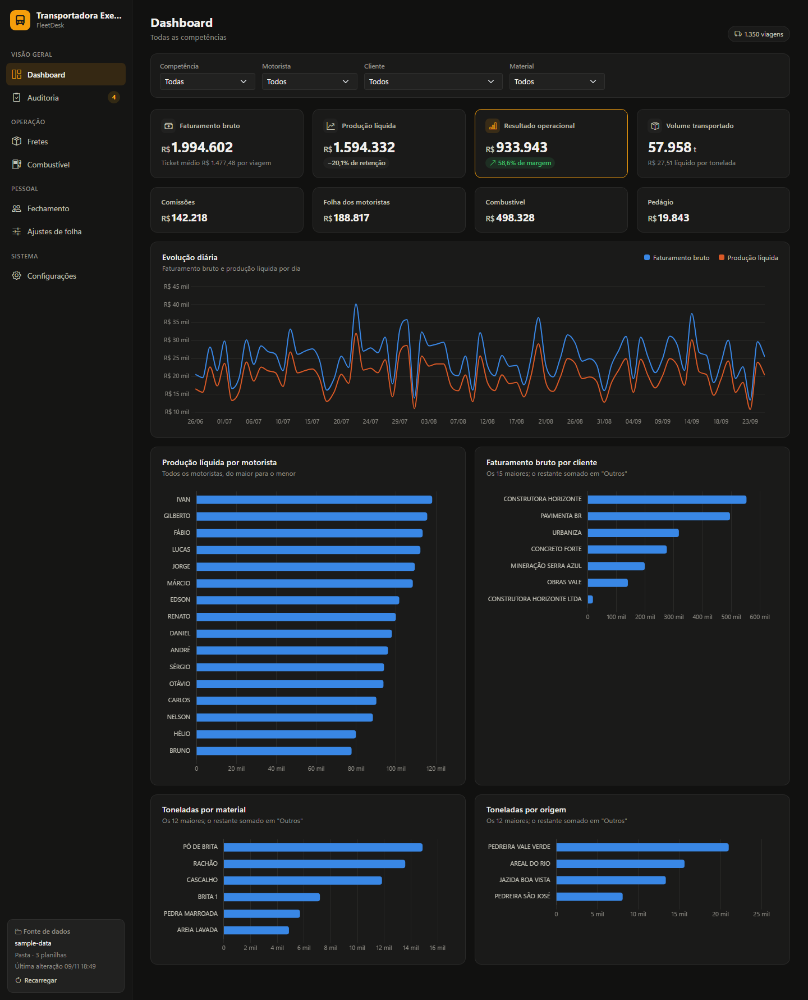
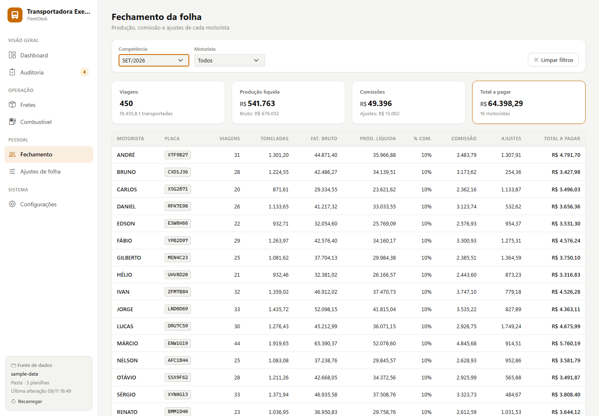
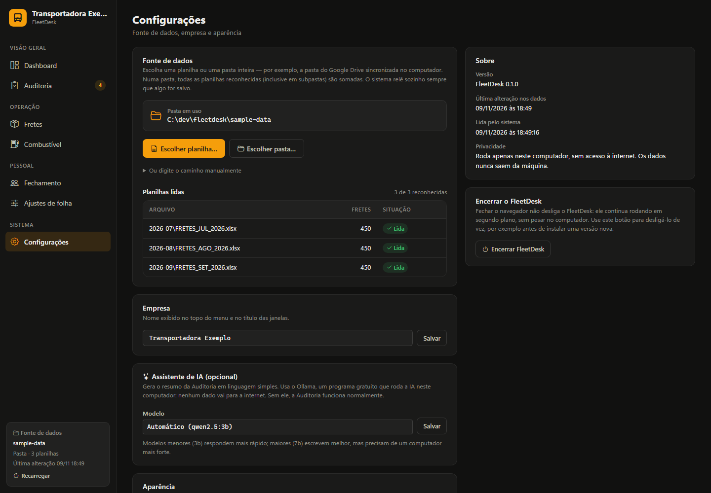
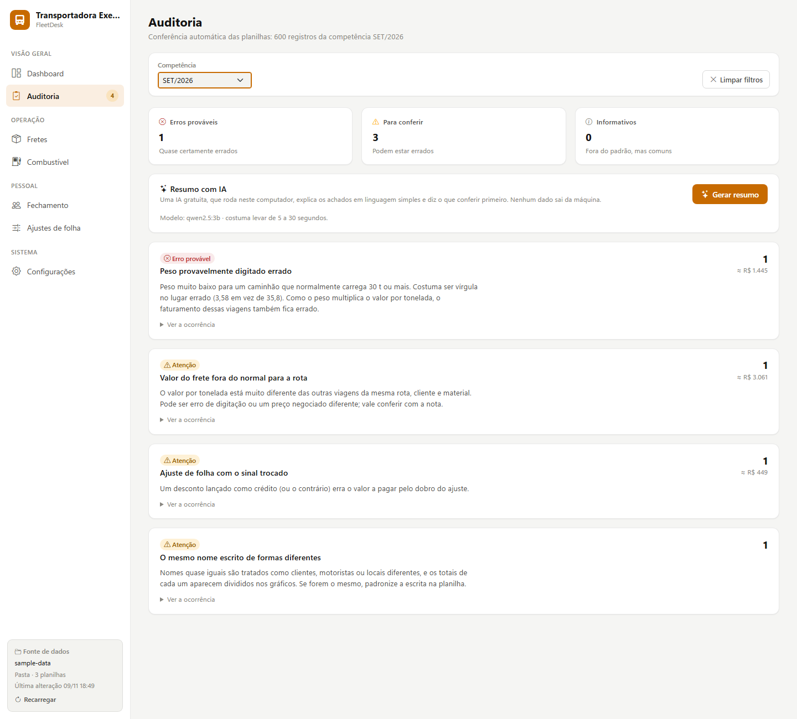

# FleetDesk

A local-first operations dashboard for small trucking companies, built on top of the Excel
workbooks they already fill in every day.



## Why

Small fleets often run on a shared Google Drive folder full of spreadsheets: drivers' trips,
fuel, tolls and payroll adjustments are typed in by staff, and the owner spends hours
copying numbers around to answer simple questions ("how much did each truck make this
month?", "what do I owe each driver?").

FleetDesk reads those workbooks **as they are**, with no migration and no change to anyone's
routine, and turns them into a dashboard, filterable tables and a payroll closing view. It
runs entirely on the owner's PC: no account, no cloud, no data leaving the machine.

> The user interface is in Brazilian Portuguese, the language of its users. Code,
> documentation and commit history are in English.

## Features

- **Dashboard**: revenue, net production, operating result and margin, tonnage, plus daily
  trend and per-driver / customer / material / origin breakdowns.
- **Freights, Fuel, Payroll closing and Payroll adjustments** pages with filters by pay
  period (*competência*), driver, customer and material.
- **Single workbook or a whole folder** as data source. Point it at the folder Google Drive
  syncs to the PC and every workbook in it (including subfolders) is merged.
- **Live reload**: a workbook is re-read only when its size or modification time changes;
  everything else is served from memory (pages render in ~5–30 ms).
- **Duplicate detection**: copies of the same workbook in the folder ("Cópia de…", old
  versions) are flagged, so totals are never silently doubled.
- **Native file and folder pickers** that keep the real path, so the dashboard follows
  the workbook as it changes.
- **Audit with a free, local AI summary**: a page that flags likely data-entry mistakes and
  points to the exact file, tab and row to fix. An optional local LLM explains them in plain
  Portuguese (see [Audit](#audit)).
- **Light, dark and system themes**, with charts redrawn to match.
- **Sample data generator** producing realistic, entirely fictitious workbooks for demos
  and tests.

| Light theme | Settings |
|---|---|
|  |  |

## Quick start

Requires Python 3.11+. Built for Windows; the test suite also runs on Linux in CI.

```powershell
git clone <this repository>
cd fleetdesk
.\scripts\dev.ps1 -Sample
```

`-Sample` creates a virtual environment, installs the project, generates three months of
fictitious workbooks in `sample-data/` and opens the app at <http://127.0.0.1:5000>.

Without the script:

```bash
python -m venv .venv
.venv/Scripts/activate            # Linux/macOS: source .venv/bin/activate
pip install -e ".[dev]"
python -m fleetdesk.sample_data sample-data --months 3
python -m fleetdesk               # then choose sample-data/ in Configurações
```

### For end users: portable zip

```powershell
.venv\Scripts\python scripts\build_portable.py
```

builds `dist/FleetDesk-<version>-windows.zip` (~16 MB). The user extracts it and
double-clicks `Iniciar FleetDesk.bat`, which creates a Desktop shortcut and opens the app.
No Python, installer, admin rights or internet connection is needed. The zip ships a
`LEIA-ME.txt` with instructions in Portuguese.

- It bundles the official **embeddable Python** from python.org plus tkinter for the native
  file pickers, instead of a PyInstaller `.exe`. An unsigned executable is blocked by
  SmartScreen and Smart App Control.
- The build verifies Authenticode signatures and **fails if any unsigned native binary** would
  ship. MarkupSafe's optional C speed-up is dropped in favour of its pure-Python fallback.
- Without a console window, logs go to `%APPDATA%\FleetDesk\fleetdesk.log`. Launching a
  second time just reopens the running instance, and *Configurações → Encerrar FleetDesk*
  stops it, for example before replacing the folder with a newer version.

`scripts/FleetDesk.bat` is the developer-machine alternative: it installs into a local
`.venv` and needs Python already installed.

## Workbook format

FleetDesk expects the company's workbook layout (tab and header names are in Portuguese):

| Tab | Content | Becomes |
|---|---|---|
| `LANÇAMENTOS` | one row per trip (required: identifies a supported workbook) | `Freight` |
| `COMBUSTÍVEL` | fuel purchases | `FuelEntry` |
| `PEDÁGIO` | toll payments | `TollEntry` |
| `AJUSTES FOLHA` | payroll deductions and additions | `PayrollAdjustment` |
| `FECHAMENTO` | payroll closing per driver | `PayrollSummary` |
| `RESULTADO POR PLACA` | result per truck | `VehicleResult` |

Columns are matched **by header text, not position** (see
[`data/schema.py`](src/fleetdesk/data/schema.py)), so inserting or reordering columns in
Excel does not break the import, and a missing required column is reported by name. A pay
period such as `SET/2026` runs from the 26th of August to the 25th of September.

Workbooks in other formats found in a folder are listed as *ignored* rather than failing
the whole import, and an unreadable file (for example one caught mid-save) keeps its last
good read.

## Audit



[`data/audit.py`](src/fleetdesk/data/audit.py) runs deterministic rules and robust statistics
over the merged data (about 60 ms for 1,600 records):

| Check | Example it catches |
|---|---|
| Weight vs. the truck's own median | `4,1 t` on a truck that usually carries 41 t (misplaced decimal point) |
| Rate vs. the route's median (customer, material, origin, destination) | R$ 90/t on a route that pays R$ 30/t |
| Similar names (accents, spacing, company suffixes, typos) | `VALE NORTE` vs `VALE NORTE ENGENHARIA` splitting a customer's totals |
| Totals, commissions, period dates, required fields, duplicates | formulas overwritten, trips filed in the wrong month |
| Payroll vs. freights and adjustments | trip counts, commissions and adjustments that do not reconcile |
| Adjustment signs, negative pay, missing fuel/toll costs, fuel outliers | a deduction entered as a credit |

Thresholds were tuned on a real month of data so that legitimate patterns, such as dozens of
short shuttle runs on one invoice, are grouped into one finding instead of flooding the page.

**AI summary (optional, free, private).** [`assistant.py`](src/fleetdesk/assistant.py) sends the
findings to a model running locally through [Ollama](https://ollama.com) (default
`qwen2.5:3b`, about 10 s on a laptop), so no data leaves the machine. The model only *explains*
what the rules found. It is never asked to find problems itself, and the prompt hands it
pre-ranked items, pre-formatted amounts and a computed opening sentence. That design came from
testing: left to assemble figures itself, a 3B model attributed amounts to the wrong item and
invented a total. With it, repeated runs reproduced every amount and row exactly. Without
Ollama the audit page works the same, minus the summary.

```powershell
# optional, once: install Ollama from ollama.com, then
ollama pull qwen2.5:3b
```

The sample generator plants four typical mistakes (`--clean` to skip them), and the tests
assert that the audit finds exactly those and nothing on clean data.

## Architecture

```
src/fleetdesk/
├── app.py            # application factory, CLI entry point, waitress server
├── settings.py       # JSON settings in %APPDATA%\FleetDesk (atomic writes)
├── assistant.py      # optional audit summary by a local LLM (Ollama)
├── dialogs.py        # native Windows file/folder pickers (tkinter)
├── formatting.py     # pt-BR number/currency Jinja filters
├── sample_data.py    # fictitious workbook generator (demos and tests)
├── data/
│   ├── models.py     # typed domain records (dataclasses)
│   ├── schema.py     # tab/header → field mapping
│   ├── workbook.py   # parse one workbook
│   ├── repository.py # folder discovery, per-file cache, merge, duplicate detection
│   ├── audit.py      # rule-based and statistical checks for likely mistakes
│   └── analytics.py  # KPIs and chart series (framework-free)
├── web/
│   ├── routes.py     # Flask blueprint with the pages
│   ├── security.py   # local-only request guard
│   └── services.py   # dependency container stored on the app
├── templates/        # Jinja templates
└── static/           # CSS, chart helpers, vendored Bootstrap / Chart.js
```

Design notes:

- **Local-first, offline.** The server binds to `127.0.0.1` and every asset is vendored, so
  the app works without internet. `waitress` serves it instead of Flask's dev server.
- **Layered.** Parsing, merging and analytics know nothing about Flask, so they are tested
  directly. Views only orchestrate.
- **Dependency injection.** Settings store, repository and file picker are passed to
  `create_app`, which is how the tests swap in temporary folders and a fake picker.
- **Defence against the browser.** A localhost server can still be reached by any page open
  in the same browser. `web/security.py` rejects foreign `Host` headers (DNS rebinding) and
  cross-origin writes (CSRF).
- **Releases file handles immediately**, so Excel and Google Drive can save over a workbook
  while the app is running.

## Development

```powershell
.\scripts\check.ps1     # ruff, ruff format --check, mypy --strict, pytest
```

The same checks run in CI on Windows and Ubuntu with Python 3.11 and 3.13
(`.github/workflows/ci.yml`). Tests build their workbooks with `sample_data.py`, so the
suite never needs real company data.

> On machines with Windows Smart App Control, the compiled `mypy` wheel may be blocked.
> Installing it from source works around this:
> `pip install --force-reinstall --no-binary mypy mypy`.

## Privacy

FleetDesk never uploads anything. Workbooks are read in place, settings live in the user's
profile, and `.gitignore` excludes every spreadsheet format so real data cannot be committed
by accident. All screenshots in this repository use generated, fictitious data.

## Roadmap

- Native desktop window (pywebview) instead of a browser tab
- Per-truck results page (`RESULTADO POR PLACA` is already parsed)
- Support for the legacy one-tab-per-driver workbook
- Month-over-month comparison and PDF export of the payroll closing

## License

[MIT](LICENSE). Bundles [Bootstrap](https://getbootstrap.com),
[Bootstrap Icons](https://icons.getbootstrap.com) and [Chart.js](https://www.chartjs.org),
all MIT-licensed.
